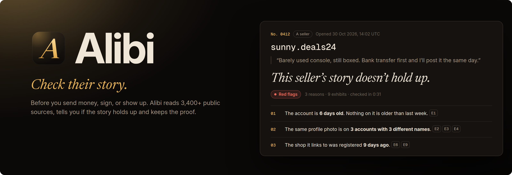
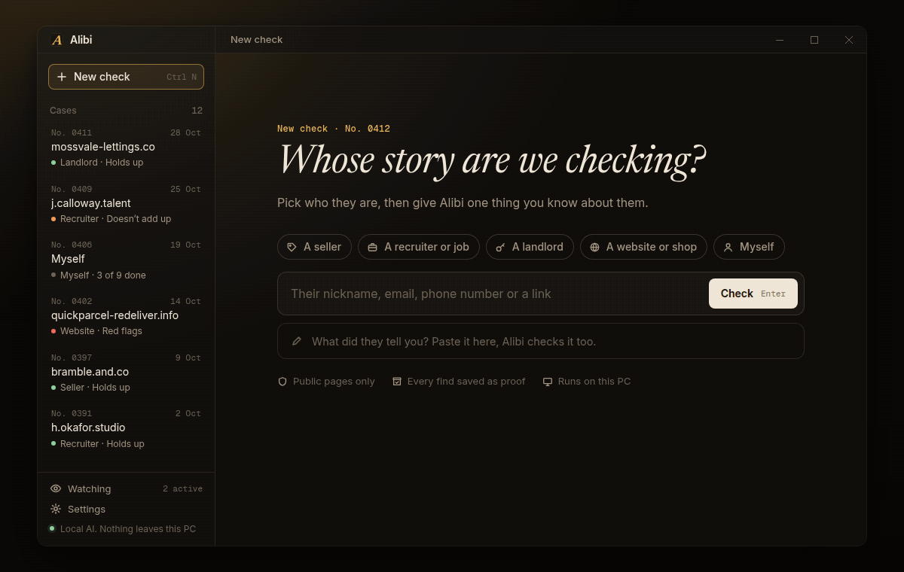
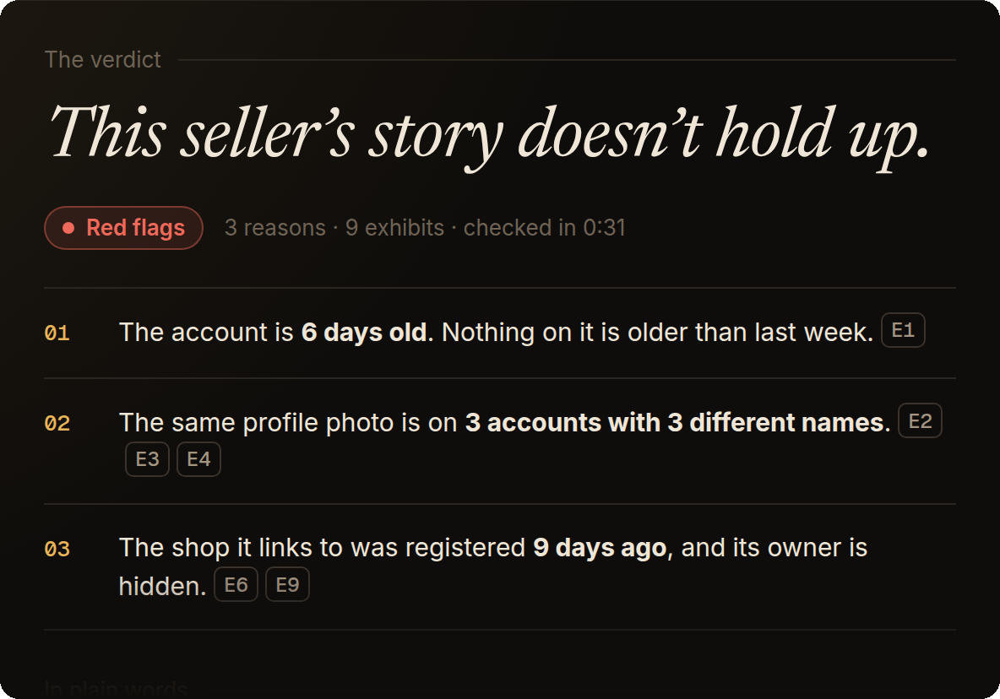
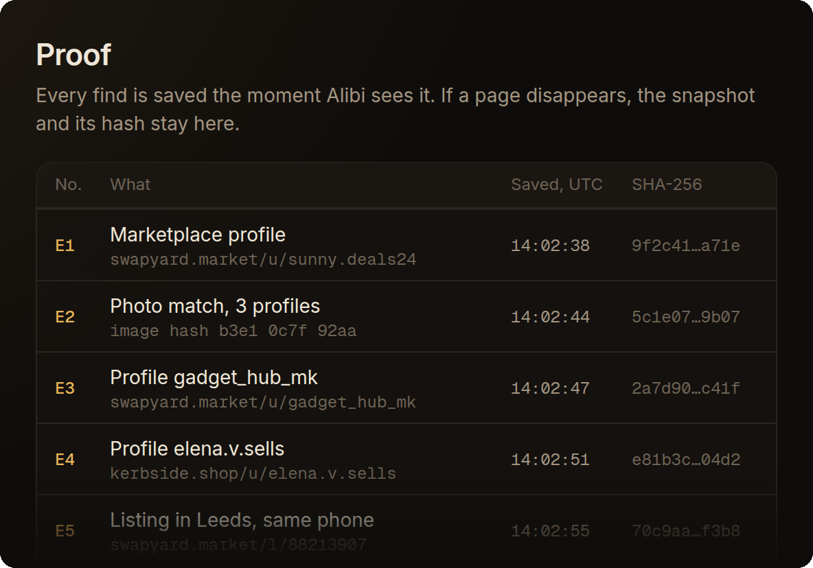
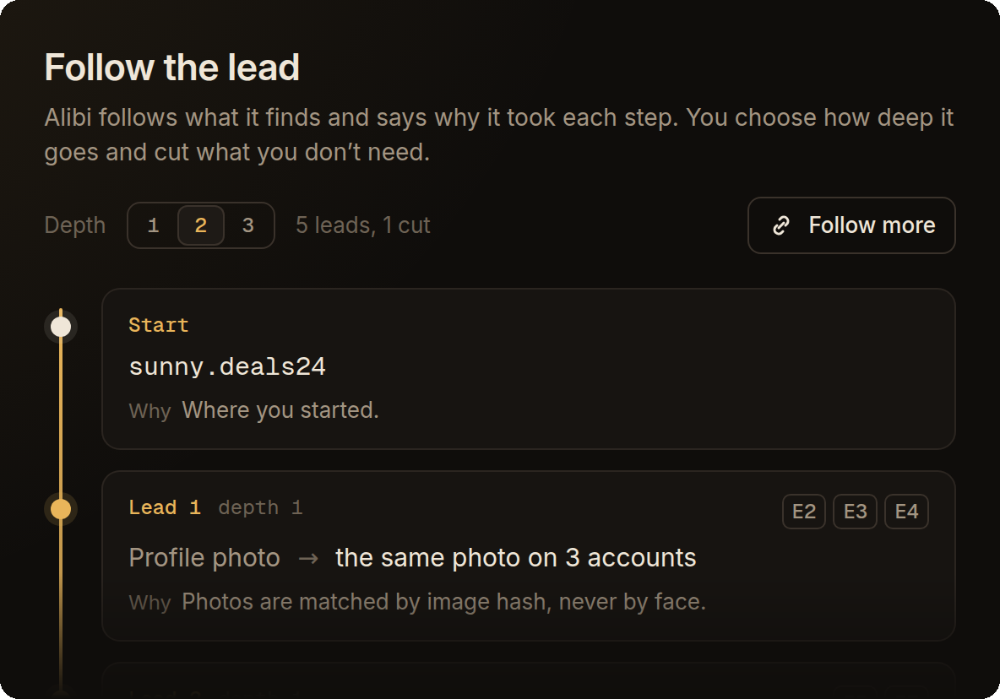
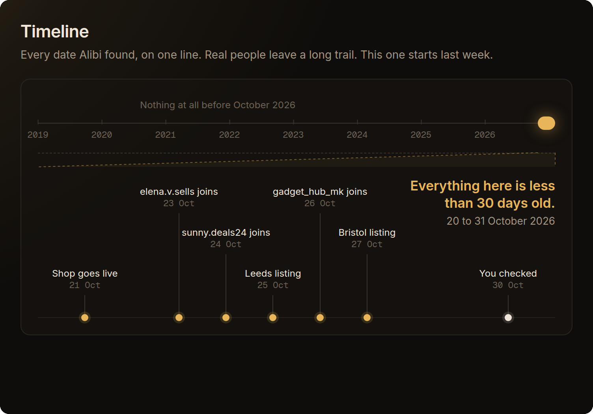
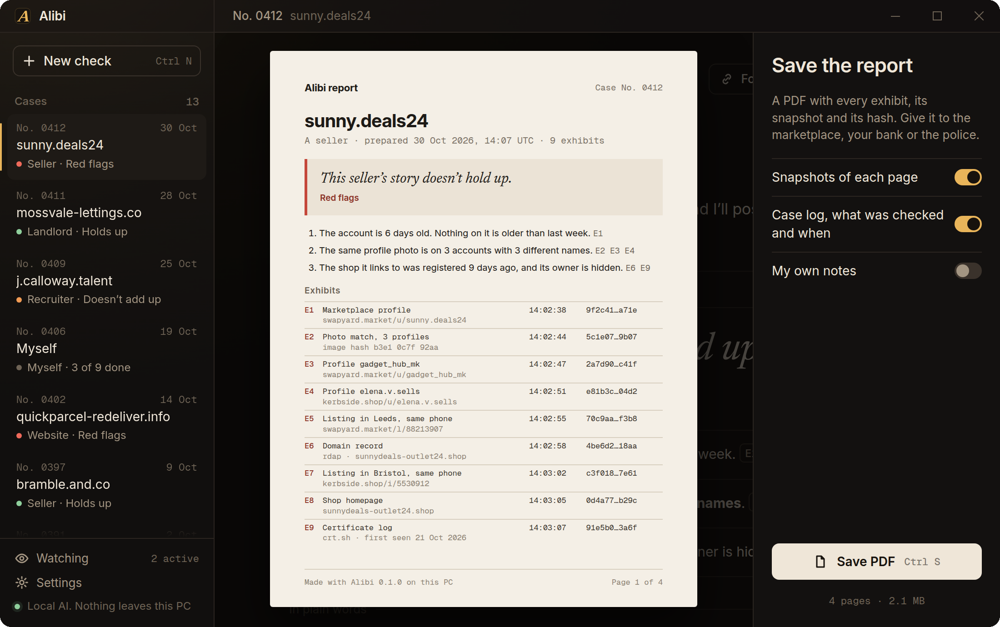
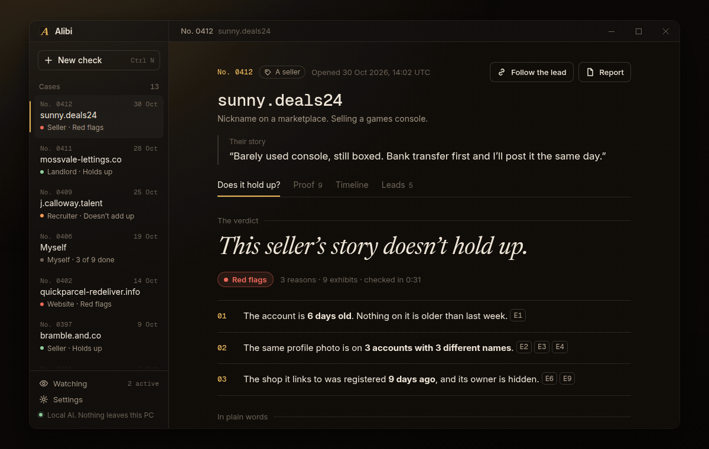
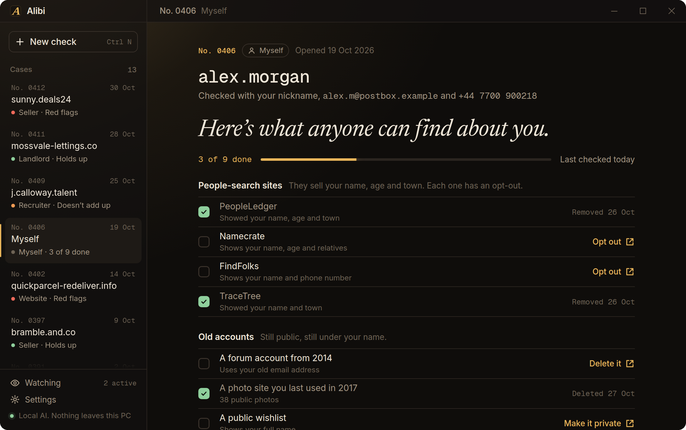

<p align="center">
  
</p>

<p align="center">
  <a href="#get-it-in-3-steps"></a>
  
  <a href="LICENSE"></a>
  
  
</p>

<p align="center">
  <a href="#get-it-in-3-steps">Download</a> ·
  <a href="#what-it-does">What it does</a> ·
  <a href="#does-it-hold-up">Does it hold up?</a> ·
  <a href="#what-alibi-wont-do">What it won't do</a> ·
  <a href="#questions">Questions</a>
</p>

<p align="center">
  
</p>

<h3 align="center">Spot a scammer like a pro investigator. 30 seconds, $0.</h3>

## They have a story. Does it hold up?

The seller with a boxed console and a "bank transfer first" rule. The recruiter paying £42 an hour for data entry. The landlord who's somehow never free for a viewing.

Everyone has a story. **Alibi checks it in about 30 seconds**, before you send money, sign anything or show up. It reads 3,400+ public sources, tells you in one line whether the story holds up, and keeps the proof for every word of it.

Free. No account. Runs on your PC.

## What it does

<table>
  <tr>
    <td width="50%"></td>
    <td width="50%"></td>
  </tr>
  <tr>
    <td><b>Does it hold up?</b> One verdict, three reasons, and the proof behind each one.</td>
    <td><b>Proof.</b> Every find saved with a snapshot, a time and a hash. Deleted pages stay proven.</td>
  </tr>
  <tr>
    <td></td>
    <td></td>
  </tr>
  <tr>
    <td><b>Follow the lead.</b> Alibi chains what it finds and says why it took each step.</td>
    <td><b>Timeline.</b> Real people leave a long trail. Fake ones start last week.</td>
  </tr>
</table>

## Get it in 3 steps

**1. Download** the file from the [latest release](https://github.com/Blazenumenhir/scam-story-checker/releases/latest):

| System | File |
|---|---|
| Windows 10 and 11 | [`scam-story-checker.zip`](releases/latest) |

**2. Open it.** No installer, no admin rights, no sign-up.

**3. Pick who you're checking, paste what you know, press Enter.** A nickname, an email, a phone number or a link is enough. Paste what they told you too, and Alibi checks that as well.

> [!NOTE]
> `Main.exe` is code-signed, so Windows starts it without a warning. Keep `alibi` next to it: they ship together.

## Does it hold up?

Start by saying who they are: **a seller**, **a recruiter or job**, **a landlord**, **a website or shop**, or **yourself**. Alibi runs the checks that matter for that kind of story and words the verdict to fit.

| Verdict | What it means |
|---|---|
| **Holds up** | The public trail matches what they told you. |
| **Doesn't add up** | Some of it checks out and some of it doesn't. Alibi says which part. |
| **Red flags** | The trail contradicts the story. Don't send money first. |

Every reason points at its exhibits, and a reason with no exhibit is never shown. The summary in plain words is written on your PC from those exhibits, so it can't add facts that aren't there.

## Proof

Scam pages vanish the moment someone gets suspicious. Alibi saves each find the second it sees it:

- a snapshot of the page, kept on your PC
- a copy on the Wayback Machine
- the time, in UTC
- a SHA-256 hash, so anyone can tell the file hasn't been touched

One click turns the case into a PDF that your bank, the marketplace or the police can work with.

<p align="center">
  
</p>

## Follow the lead

Press **Follow the lead** and Alibi keeps going on its own. The profile photo turns up on two more accounts. The phone number turns up on two more listings. The shop link turns out to be a domain registered last week.

Every step says why it was taken. You set the depth, from 1 to 3 steps, and cut any branch you don't want followed.

<p align="center">
  
</p>

## Timeline

Every date Alibi finds goes on one line: when the accounts were made, when the domain was registered, when the first listing went up. A real seller has years behind them. A fake one is a cluster from last week, and Alibi points it out.

## Also in the box

- **Check yourself.** See what anyone can find about you, then clear it up: opt-out links for people-search sites, old accounts to delete, breaches to deal with.
- **Watch.** Get told when something new shows up. It works for yourself, your own domains and companies, never for a private person, and every watch has an end date.
- **Local AI.** Summaries run on your PC through [Ollama](https://ollama.com), or you can switch AI off. Nothing leaves the PC unless you pick an online model yourself.
- **One-click PDF.** Exhibits, hashes and the case log in one file.

<p align="center">
  
</p>

## What Alibi won't do

- Look up home addresses.
- Search for a stranger's face. Photo matching compares image hashes, never faces.
- Log in anywhere, or read anything behind a login.
- Show anyone's live location.
- Probe password-reset or sign-up pages to see if an account exists.
- Hammer websites. Requests are polite and rate-limited.

Every case keeps a log of what was checked and when.

## Use it right

Alibi only reads public information, but public doesn't mean fair game.

- Check people you're about to deal with. That's what it's for.
- If you check someone for a client, under GDPR you're the data controller and need a legitimate-interest reason. Keep only what you need.
- **Alibi isn't a consumer reporting agency.** Don't use it to screen tenants or job applicants, or to make credit, insurance or hiring decisions (US FCRA). Checking a landlord or a recruiter before you deal with them is fine. Screening applicants isn't.
- Never use it to follow, harass or expose anyone.

## Where the data comes from

| Data | Source |
|---|---|
| Accounts on 3,400+ sites | Public profile pages and public APIs, defined in [`sources/sites.toml`](sources/sites.toml) |
| Snapshots | Your PC, plus the Wayback Machine |
| Domains | RDAP, and WHOIS for country domains that still use it |
| Certificates | crt.sh, with CertSpotter as a fallback |
| Mail setup | DNS over HTTPS (MX, SPF, DMARC) |
| Email avatars | Gravatar |
| Breaches | Have I Been Pwned. The breach list is free; email search uses your own key, if you add one |

No paid keys are needed. Anything optional lives in **Settings**.

## Build from source

You need Rust 1.85 or newer and the [Tauri prerequisites](https://v2.tauri.app/start/prerequisites/) for your system.

```bash
git clone https://github.com/Blazenumenhir/scam-story-checker.git
cd scam-story-checker
cargo test --workspace
cargo tauri build
```

| Path | What's inside |
|---|---|
| `crates/alibi-core` | Verdicts, exhibits and reasons |
| `app/` | The window and its icons |
| `sources/` | The public sources Alibi checks |
| `assets/` | Images for this README |

## Questions

<details>
<summary><b>Is it really free?</b></summary>

Yes. Every feature, no trial, no paid tier, no account. Everything works without paying for anything. If you already have a Have I Been Pwned key, you can add it for email breach search.
</details>

<details>
<summary><b>Will they know I checked them?</b></summary>

Alibi opens public pages the same way your browser does, and nobody gets a notification. One thing to know: Wayback Machine copies are public on archive.org. If you'd rather keep a case private, switch them off in **Settings** and keep local snapshots only.
</details>

<details>
<summary><b>How sure is a verdict?</b></summary>

As sure as the public trail. A verdict is a summary of what's out there, not a judgement on a person. That's why every reason shows its exhibits: you can open each one and decide for yourself.
</details>

<details>
<summary><b>Does it work without AI?</b></summary>

Yes. Checks, verdicts, proof, leads and the timeline don't need AI. AI only writes the summary in plain words, and it runs on your PC.
</details>

<details>
<summary><b>Is it legal?</b></summary>

Alibi reads public pages and public records, which is legal in most places. What you do with the results is on you: read [Use it right](#use-it-right) before checking anyone for someone else.
</details>

<details>
<summary><b>Is Alibi like Sherlock, Maigret or OSINT Industries?</b></summary>

Same idea: one name checked against thousands of public sites. The difference is what you get back. Instead of a list of links, Alibi tells you whether the story holds up and keeps the proof. Unlike paid lookup services, it's free and runs on your PC.
</details>

## License

Alibi is [MIT](LICENSE) licensed.

The UI bundles Inter, Newsreader and Geist Mono, all under the SIL Open Font License 1.1.

Alibi isn't affiliated with any site it checks. Site names belong to their owners.

Sherlock, Maigret and OSINT Industries are independent projects and products, named for comparison only. Alibi isn't affiliated with them.
